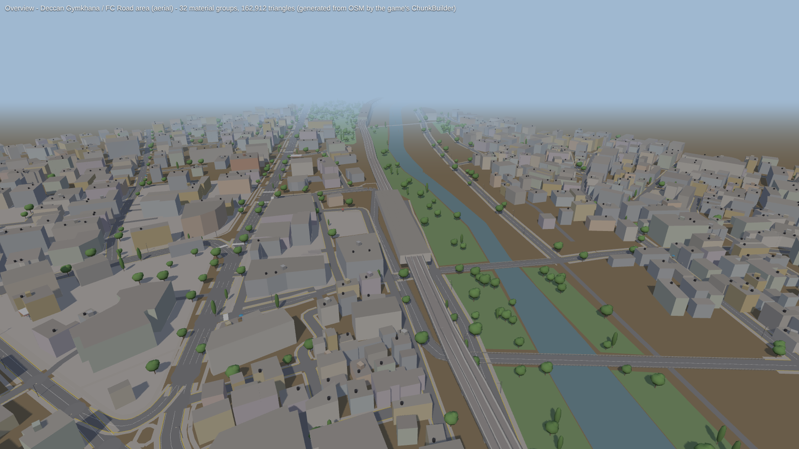

# SHEHAR – Open-World India (Unity prototype: Pune)

An open-world driving and adventure game set in **geographically accurate Indian cities**.
Every road, junction, one-way street, traffic signal, building footprint, park, river and metro line comes from **OpenStreetMap**. Nothing in the street layout is invented.

> **Name note:** the brief called the project "GTA India". *GTA* is a Rockstar Games trademark, so the game ships under an original title, **Shehar** (Hindi/Marathi for "city"). The gameplay is an original take on the open-world driving genre. It does not reuse any existing game's characters, art, music or levels.

Phase 1 delivers a playable **Pune** prototype built in **Unity** (Unity 2021.3 LTS or newer, built-in render pipeline). The data pipeline doesn't depend on any engine, so the planned **Unreal Engine 5** port reuses it. See [`Docs/UNREAL_PORT.md`](Docs/UNREAL_PORT.md).


*The game's own `ChunkBuilder` output for Deccan Gymkhana / FC Road (run headless and rendered in WebGL for verification). It shows real roads with lane markings and black-yellow kerbs, the Mula-Mutha river and riverside parks, bridges, the elevated Pune Metro, and rooftop water tanks.*

---

## 1. Quick start (Unity)

1. Install **Unity Hub** and **Unity 2021.3 LTS** (2022.3 LTS and Unity 6 also work; the Hub offers to upgrade the project).
2. In Unity Hub choose **Add → Add project from disk** and select `Shehar/UnityProject`.
3. Open the project. The first time, an editor script creates `Assets/Scenes/Main.unity` and adds it to Build Settings (menu: **Shehar → Create or Open Main Scene**).
4. Press **Play**. The game boots on its own (`GameManager` uses `RuntimeInitializeOnLoadMethod`): main menu → **Start Game** → **Pune** → choose a mode → **PLAY**.
5. To ship a build, use **File → Build Settings → Build** (PC, Mac & Linux Standalone).

The city data is already generated and committed in `Assets/StreamingAssets/Cities/pune/` (8 MB). You don't need internet access to play.

## 2. Controls (all remappable in Settings → Controls)

| Key | Action | Gamepad |
|---|---|---|
| W / S | Accelerate / brake & reverse (walk forward / back on foot) | Left stick |
| A / D | Steer left / right | Left stick |
| Space | Handbrake (drift) / jump on foot | A |
| Shift | Boost in vehicles / sprint on foot | RB |
| E | Enter / exit a vehicle (you can also take one from traffic) | Y |
| F | Interact: start a mission, refuel at a petrol pump, buy street food | X |
| C | Switch between third-person and first-person camera | B |
| M | City map (scroll to zoom, drag to pan, right-click to set GPS) | Back |
| Tab | Missions menu | – |
| Esc | Pause menu | Start |
| R | Reset vehicle onto the nearest road | R3 |
| H / L / G | Horn / headlights / siren (police and ambulance) | LB = horn |
| Mouse | Look / orbit the camera | – |

## 3. What's in the Pune prototype

| Area | Implemented (verified as noted in §6) |
|---|---|
| **Geography** | A 6.3 km × 6.6 km OSM extract (bbox 18.497–18.557 N, 73.818–73.878 E): Shivajinagar, Deccan Gymkhana, FC Road, JM Road, Karve Road, University Road towards SPPU, Kasba / Sadashiv / Shaniwar Peth, Swargate, Pune Station, Sangamwadi. 8,249 road ways, 24,161 drivable edges, 20,983 buildings, 103 large areas (river, parks, campuses), 21 named landmarks, 34 petrol pumps, 325 traffic-signal nodes, Pune Metro (elevated sections) and railway. |
| **3D world** | Chunk-streamed 3D city (250 m chunks, background-thread generation, near and far detail levels). Extruded buildings with window-facade textures whose windows light up at night, temple shikharas, rooftop water tanks, roads with lane markings, zebra crossings, kerbs and footpaths, bridge parapets, metro viaduct and stations on pillars, trees, street lights, petrol-pump canopies and street-food carts. |
| **Driving** | Raycast-suspension physics: spring and damper, slip-angle tyres with a friction circle, power-limited engine, auto gearbox, handbrake drifts, anti-roll bars, drag, wet-road grip loss, collision damage with engine smoke, and fuel. **12 vehicle types**: hatchback, sedan, SUV, sports coupe, auto-rickshaw (3 wheels), scooter, motorcycle, taxi, police SUV, ambulance, city bus and goods truck. Cars are right-hand drive, with MH-12/MH-14 plates in white (private) or yellow (commercial). |
| **Cameras** | Third-person chase/orbit and first-person (driver's seat with dashboard, or eye level on foot). Both have collision, speed FOV and crash shake. |
| **Traffic & NPCs** | AI traffic drives the real road graph, **keeps left**, respects one-way streets, stops at the OSM signals, slows for speed breakers and turns, keeps its distance, honks and yields to sirens. The mix is two-wheeler and auto-heavy. Pedestrians in shirts, kurtas and sarees walk the footpaths, jaywalk and can be knocked down. |
| **Navigation** | GPS uses A* over the real graph and is one-way aware. It shows a route ribbon on the road, turn-by-turn instructions with real street names, re-routes automatically, and draws a rotating minimap plus a full map that shows the street name and lat/lon under the cursor. |
| **Missions (8)** | Story 1 *Welcome to Pune* (Pune Station → Dagdusheth Halwai Ganpati → Fergusson College) · Story 2 *Peshwa Heritage Trail* (Shaniwar Wada, Lal Mahal, Kasba Ganpati, Nana Wada, Vishrambag Wada) · Story 3 *FC Road–JM Road Night Sprint* (time trial along the real one-way pair) · *Rickshaw Fares* (3 metered fares) · *Hot Food Express* (delivery) · *Golden Hour* (ambulance run to Sassoon Hospital) · *Know Your City* (exploration) · *Driving Licence Test*. |
| **Modes** | Free Roam, Story, Driving Simulator (enforces speed limits, red lights, wrong-way driving, collisions and pedestrian hits, with fines), Mission Mode and Career (₹ money, vehicle purchases, fuel, fines and saved progress). Multiplayer is shown but marked as a future phase. |
| **World systems** | Day/night cycle, dynamic weather (clear, cloudy, haze, rain, thunderstorm with lightning and thunder), wet roads, procedurally synthesised audio (engines per vehicle type including the auto-rickshaw's putt-putt, horns, siren, rain, city ambience with distant honking). |
| **UI** | Main menu, 3D "Explore India" city board (pins placed by real lat/lon), mode select, garage with a 3D turntable, missions, career stats, settings, key rebinding, pause menu, loading screen with OSM attribution, and a full HUD (speedometer, gear, RPM, fuel, damage, ₹ money, clock, weather, objectives, timer, GPS, speed-limit sign and driving score). |

## 4. Repository layout

```
Shehar/
├── UnityProject/                    Unity project (open this folder)
│   ├── Assets/Shehar/Scripts/        runtime C# (asmdef Shehar.Runtime)
│   │   ├── Core/                    engine-independent data model, road graph + A*, triangulation
│   │   ├── City/                    chunk streaming, mesh generation, materials, map raster, signals
│   │   ├── Vehicles/                specs, procedural models, physics controller
│   │   ├── Player/                  on-foot controller, humanoid, camera rig
│   │   ├── AI/                      traffic + pedestrians
│   │   ├── Navigation/              GPS
│   │   ├── Missions/                mission framework, Pune missions, traffic-rule enforcement
│   │   ├── World/                   day/night, weather, particles
│   │   ├── Audio/                   synthesised sounds
│   │   ├── UI/                      IMGUI toolkit, HUD, map
│   │   └── Game/                    GameManager (entry point), input, save data, menu scene
│   ├── Assets/Shehar/Resources/Shaders/   CityLit, CityCutout, UnlitTransparent, Sky
│   ├── Assets/Shehar/Editor/        scene bootstrap + menu
│   ├── Assets/Shehar/Tests/         PlayMode smoke test
│   └── Assets/StreamingAssets/Cities/pune/   generated city data (index.json, global.json, chunks/*.json)
├── Tools/osm_pipeline/              fetch_osm.py, build_city.py, render_preview.py, cities.json
├── Tools/preview/                   WebGL viewer used to visually verify generated meshes
├── Tests/CoreTests/                 .NET tests of Core against the real Pune data
├── Tests/GeometryHarness/           runs the real ChunkBuilder/MapRaster headless on all chunks
├── Tests/UnityCompileCheck/         compiles all runtime scripts against Unity reference assemblies
├── Tests/EditorCompileCheck/        same, plus the editor script and PlayMode test
└── Docs/                            data sources and licences, Unreal port plan, images
```

## 5. Regenerating or adding a city

```bash
cd Shehar/Tools/osm_pipeline
```

```bash
python3 fetch_osm.py pune          # downloads OSM tiles for the bbox in cities.json (needs api.openstreetmap.org)
```

```bash
python3 build_city.py pune         # writes UnityProject/Assets/StreamingAssets/Cities/pune/
```

```bash
python3 render_preview.py pune     # optional: Docs/images/pune_osm_extract.png (needs matplotlib)
```

To add a city, add an entry (bbox, chunk size, spawn landmark) to `cities.json` and a landmark list to `LANDMARKS` in `build_city.py`, then run the same three commands. The Unity city board lights the city up as playable as soon as `StreamingAssets/Cities/<id>/index.json` exists. Missions are looked up by landmark/POI name, so each new city needs its own mission entries in `MissionLibrary.cs`.

## 6. Testing — what was run and what wasn't

| Check | Command | Result |
|---|---|---|
| Core tests on real data: projection, graph integrity, one-way-legal A* routes between 5 landmark pairs, triangulation of 21,688 polygons | `cd Tests/CoreTests && dotnet run -c Release` | **PASS**. Routes such as Fergusson College → Pune Station follow Gokhale Path (FC Road) → Ganeshkhind Road → H. K. Firodia Bridge. |
| Every runtime script compiled against Unity 2021.3 reference assemblies | `cd Tests/UnityCompileCheck && dotnet build` | **PASS** (0 errors, 0 warnings) |
| Editor script and PlayMode test compiled | `Tests/fetch_refs.sh && cd Tests/EditorCompileCheck && dotnet build` | **PASS** |
| Real `ChunkBuilder` + `MapRaster` on all 701 chunks, headless | `cd Tests/GeometryHarness && dotnet run -c Release` | **PASS**. 5.5 M vertices, no NaN or out-of-range indices, about 4–6 ms median per chunk on one worker thread. |
| Visual check of generated meshes (WebGL, headless Chromium) | `cd Tools/preview && node render.js` | Renders in `Docs/images/`. This check found and fixed solid metro stations over roads. |
| **In-engine play test** | Unity Test Runner → PlayMode → `PuneSmokeTest` | **Not run here.** The build environment has no licensed Unity Editor. The test loads Pune, drives the car, and checks streaming, traffic, GPS and mission start. Run it after opening the project. |

**Be aware:** vehicle feel, AI behaviour, UI layout and shader output have been written and reviewed but **not yet observed running inside Unity**. Expect a tuning pass (suspension stiffness, grip, AI spacing) after the first play session.

## 7. Known limitations (Phase 1)

- **Terrain is flat.** No elevation model has been applied yet, so Parvati/Vetal hill rise and flyover ramps are not modelled. Flyovers and bridges sit at ground level, except elevated metro sections and stations, which are raised. *(Next: SRTM/Cartosat DEM + `layer`-based ramps.)*
- **Building heights:** only about 1.4 % of OSM buildings in this extract carry `height` or `building:levels`. The rest use a documented heuristic (`build_city.py → building_height`). Landmarks use OSM footprints, not hand-modelled 3D.
- Vehicles, characters and textures are procedural low-poly placeholders, so the repo stays asset- and licence-clean. Swap in authored models later.
- Bund Garden lies just outside the extract's east edge, so it isn't placed. Only 2 OSM speed breakers exist in this area.
- Trains, metro rides, helicopters, boats and multiplayer are Phase 3–4 items. The rail and metro geometry is already in the data.

## 8. Licence and attribution

Map data © **OpenStreetMap contributors**, available under the [Open Database License (ODbL 1.0)](https://www.openstreetmap.org/copyright). The attribution appears on the loading screen, the minimap, the map and the HUD. Derived city data in `StreamingAssets/Cities/` is a Produced Work / Derivative Database under ODbL. See [`Docs/DATA_SOURCES.md`](Docs/DATA_SOURCES.md).
